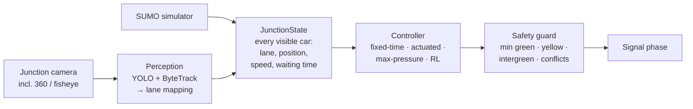

# Smart Traffic Lights

**A reinforcement-learning traffic-signal controller that picks the light phase from where the cars actually are. It is benchmarked against classical baselines in simulation, and a computer-vision pipeline gets its input from junction cameras.**

> 🚧 Work in progress. See the [roadmap](#roadmap) below.

<!-- Demo GIF / 60-second video goes here (M4) -->

---

## The problem
Most traffic lights run on fixed timers or simple sensor rules. They give green to empty roads while queues build up on the cross street. This project asks a simple question: **if a controller can see where every car is, how much better can it do?**

"Better" is defined by these metrics:

| Metric | Why it matters |
|---|---|
| Average wait per vehicle | Overall efficiency |
| 95th-percentile wait | Fairness: no approach starves |
| Throughput | Vehicles served per hour |
| Average queue length | Congestion and spill-back risk |

## How it works

- **Perception** turns camera footage into a `JunctionState`: every visible car's lane, position, speed and waiting time. The simulator produces exactly the same structure, built by the same code.
- **Controllers** only see `JunctionState`, never pixels. The same controller therefore runs on simulated traffic (for training and evaluation) and on real footage (for the demo).
- **The safety guard** sits outside every controller, including the learned one. The RL agent can only choose among safe transitions.

## Controllers compared
| Controller | Description |
|---|---|
| Fixed-time | Classic timer-based cycle |
| Actuated | Extends green while vehicles keep arriving |
| Max-pressure | Serves the phase with the largest upstream-minus-downstream queue difference. A strong, well-studied baseline |
| **RL (DQN / PPO)** | Learns a policy from lane-level state, trained in SUMO |

## Results
_Coming in M2. All numbers are on held-out traffic scenarios over 10+ seeds, with 95% confidence intervals._

| Controller | Avg wait (s) | P95 wait (s) | Throughput (veh/h) | Avg queue |
|---|---|---|---|---|
| Fixed-time | – | – | – | – |
| Actuated | – | – | – | – |
| Max-pressure | – | – | – | – |
| RL | – | – | – | – |

## Quickstart
_Coming soon._ Planned: a single Docker command that runs the benchmark and reproduces the results table.

## Tech stack
Python · SUMO / TraCI · Gymnasium · Stable-Baselines3 · PyTorch · Ultralytics YOLO · ByteTrack · OpenCV · pytest · Docker · GitHub Actions · Streamlit

## Roadmap
- [x] **M0**: Project scope, architecture, repo setup
- [ ] **M1**: Simulated junction, baseline controllers, safety guard, benchmark harness
- [ ] **M2**: RL controller, reward ablations, held-out evaluation
- [ ] **M3**: Perception pipeline (detection, tracking, lane counting, fisheye handling) with counting-error evaluation
- [ ] **M4**: End-to-end demo (camera → state → controller), side-by-side video, Docker
- [ ] _Stretch_: multi-junction coordination, pedestrian and emergency-vehicle priority, edge deployment (ONNX)

## Limitations
- Controllers are trained and evaluated in simulation. A real deployment would need to close the sim-to-real gap: perception noise, occlusion, sensor failure, and driver behavior that differs from SUMO's models.
- Perception is evaluated on public datasets, not on a live installation.

## Datasets & references
- [SUMO](https://eclipse.dev/sumo/): Simulation of Urban MObility
- [sumo-rl](https://github.com/LucasAlegre/sumo-rl): RL environments for traffic-signal control
- UA-DETRAC, AI City Challenge, FishEye8K: vehicle detection and tracking datasets
- Varaiya, _Max pressure control of a network of signalized intersections_ (2013)
- Israel Ministry of Transport, [_Traffic Signal Planning Guidelines_ (הנחיות לתכנון רמזורים), 2025](https://www.gov.il/BlobFolder/guide/planning_traffic_lights/he/%D7%94%D7%A0%D7%97%D7%99%D7%95%D7%AA%20%D7%9C%D7%AA%D7%9B%D7%A0%D7%95%D7%9F%20%D7%A8%D7%9E%D7%96%D7%95%D7%A8%D7%99%D7%9D.pdf): signal sequence, timings and intergreen method
